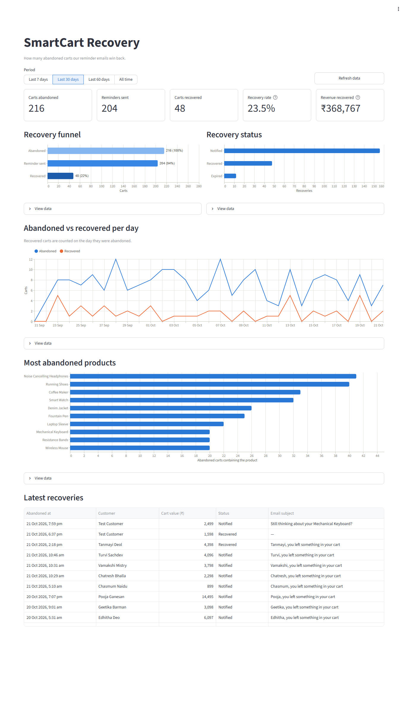

# Smart Cart Recovery System

An end-to-end Data Engineering and GenAI project built using Python, SQL, FastAPI, Kafka, PostgreSQL, Docker, Airflow, and Streamlit.

## Status
🚧 In Development



## Run locally with Docker

Requires [Docker Desktop](https://www.docker.com/products/docker-desktop/).

```
cd docker
docker compose up -d --build
```

| Service | URL |
|---|---|
| API docs (Swagger) | http://localhost:8000/docs |
| Airflow | http://localhost:8080 |
| Dashboard (Streamlit) | http://localhost:8501 |
| Postgres | `localhost:5433`, user/password `postgres` |

The `cart_recovery` DAG calls `POST /cart-recovery/detect` every 15 minutes.
A cart counts as abandoned after 30 minutes without activity; for a quick
demo, start with a shorter threshold:

```
RECOVERY_THRESHOLD_MINUTES=2 docker compose up -d     # bash
$env:RECOVERY_THRESHOLD_MINUTES=2; docker compose up -d   # PowerShell
```

Reminder emails need `SMTP_*` values in the project's `.env`. Add
`GEMINI_API_KEY` (free from https://aistudio.google.com/apikey) to have
Gemini write each email; without it a plain template email is sent.

To fill the dashboard with about 60 days of demo shop history (fake
customers on the reserved `shop.example` domain, never emailed):

```
docker compose exec api python -m backend.scripts.seed_demo_data
```

Add `--reset` to delete **all** existing data first.

Stop with `docker compose down`. Data is kept in a Docker volume;
`docker compose down -v` deletes it and recreates the database from
`database/schema.sql` on the next start.
